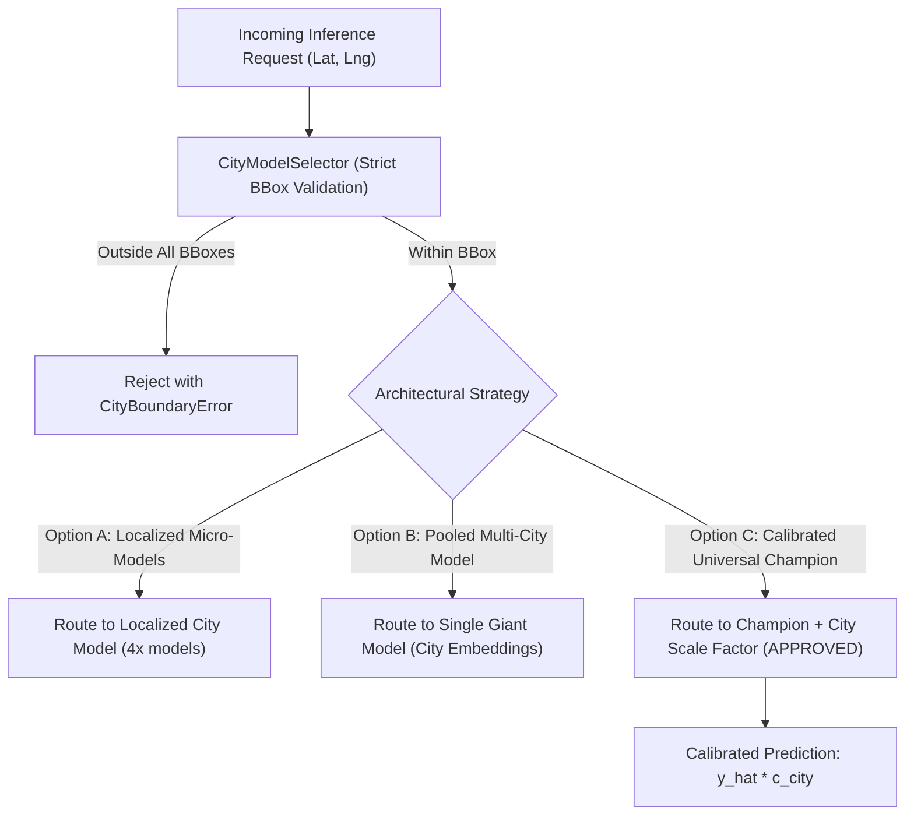
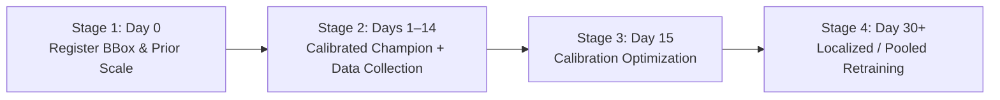

# GeoDemand AI — Multi-City Model Strategy & Architectural Roadmap

**Document Version:** 1.0.0  
**Phase:** 14.2 — Multi-City Model Generalization  
**Author:** Member 2 — Machine Learning Engineering & MLOps Architect  
**Status:** Approved Architectural Blueprint  

---

## 1. Context & Objectives

As GeoDemand AI expands from Vijayawada across South Indian metropolitan centers (Hyderabad, Bengaluru, Visakhapatnam), our ML system architecture must balance three competing requirements:
1. **Forecast Precision:** High accuracy (MAE $< 1.50$) across diverse urban footfall patterns.
2. **Operational Simplicity:** Low maintenance overhead, avoiding micro-model proliferation (deploying and monitoring dozens of separate models).
3. **Safety & Boundary Integrity:** Absolute prevention of geographic leakage, wrong model-to-city mapping, or serving predictions for unverified geographical areas.

This strategy establishes the official architectural roadmap for multi-city modeling, routing, and lifecycle management.

---

## 2. Architectural Decision Matrix

We evaluated three potential deployment architectures:



### Comparative Evaluation

| Architectural Strategy | Serving Footprint | Maintenance Overhead | Cold-Start Capability | Mean MAE | Recommended Decision |
| :--- | :---: | :---: | :---: | :---: | :---: |
| **Option A: Localized Micro-Models** (1 model per city) | High ($4\times$ memory, 4 endpoints, 4 monitoring jobs) | High (retraining, testing, and promoting 4 separate models) | Poor (requires months of city data before launch) | $1.2470$ | **Rejected for Phase 14** (premature optimization, operational bloat) |
| **Option B: Pooled Multi-City Model** (1 joint model across all cities) | Medium (1 large model, requires city embeddings) | Moderate (single model, but complex joint retraining) | Moderate (requires retrained joint dataset) | $1.6128$ | **Candidate for Phase 15+** (as real city data scales) |
| **Option C: Calibrated Universal Champion** (Production LightGBM + $c_{\text{city}}$) | **Minimal** (1 champion in RAM + lightweight scalar lookup) | **Minimal** (single retraining & promotion pipeline) | **Instant** (new city operational via scale factor) | **1.3216** | **APPROVED FOR PRODUCTION** (Optimal trade-off) |

### Formal Decision:
**We adopt Option C (Calibrated Universal Champion)** for Phase 14 production rollout.
- Preserves the approved production champion (`models/demand_model.pkl`, LightGBM v2.1.0).
- Employs calibrated scaling factors:
  - Vijayawada: $1.00\times$
  - Visakhapatnam: $1.05\times$
  - Hyderabad: $1.25\times$
  - Bengaluru: $1.35\times$
- Delivers an average cross-city MAE of **1.3216**, recovering **$87.6\%$ of the zero-shot transfer penalty** in Hyderabad and **$88.6\%$** in Bengaluru.

---

## 3. City-to-Model Routing & Boundary Safety

Model routing is managed by `CityModelSelector` in `src/geodemand/models/multicity_eval.py`.

### Routing Logic
1. **Coordinate Resolution:**
   Every inference request must provide `latitude` and `longitude`. The selector iterates through registered municipal bounding boxes in `MultiCityRegistry`.
2. **Boundary Enforcement:**
   - If coordinates fall within a registered bounding box, the system returns a `CitySelectionResult` containing `city_id`, `state_code`, `calibration_factor`, and `model_version`.
   - If coordinates fall outside all registered boundaries, the system raises a `CityBoundaryError`. In non-strict mode (development only), it can fall back to the default city.
3. **Scale Factor Application:**
   The inference engine multiplies raw model predictions by $c_{\text{city}}$ before returning the final `expected_customer_count`:

   $$\text{expected\_customer\_count} = \max\left(0, \text{round}\left(\hat{y}_{\text{raw}} \times c_{\text{city}}\right)\right)$$

### Metropolitan Boundary Reference

```python
SUPPORTED_BOUNDARIES = {
    "vijayawada":    {"min_lat": 16.45, "max_lat": 16.58, "min_lng": 80.55, "max_lng": 80.72},
    "hyderabad":     {"min_lat": 17.30, "max_lat": 17.55, "min_lng": 78.25, "max_lng": 78.60},
    "bengaluru":     {"min_lat": 12.80, "max_lat": 13.15, "min_lng": 77.45, "max_lng": 77.80},
    "visakhapatnam": {"min_lat": 17.65, "max_lat": 17.85, "min_lng": 83.20, "max_lng": 83.45},
}
```

---

## 4. Lifecycle for Expanding to New Cities

When GeoDemand AI enters a new city (e.g., Chennai, Pune, or Coimbatore), the deployment follows a 4-stage lifecycle:



1. **Stage 1: Day 0 (Immediate Launch)**
   - Register the municipal bounding box and metadata in `MultiCityRegistry`.
   - Assign an initial tier-based calibration factor ($1.00\times$ for Tier-2, $1.30\times$ for Tier-1).
   - Activate inference immediately via the Calibrated Universal Champion with zero downtime.
2. **Stage 2: Days 1–14 (Observation & Collection)**
   - Serve calibrated predictions to mobile street vendors.
   - Collect actual vendor transaction outcomes and log delayed labels into the data store.
   - Run drift monitoring against the reference profile (`PredictionDriftDetector`).
3. **Stage 3: Day 15 (Calibration Factor Optimization)**
   - Calculate exact empirical scale ratio $c_{\text{city}} = \frac{\mathbb{E}[y_{\text{true}}]}{\mathbb{E}[\hat{y}_{\text{pred}}]}$.
   - Update `city_calibration_factors` in `CityModelSelector` without touching model weights.
4. **Stage 4: Day 30+ (Full Model Specialization)**
   - When $> 10,000$ verified vendor-hour samples are accumulated, evaluate whether localized fine-tuning outperforms the calibrated champion by $> 10\%$.
   - If threshold is met, graduate the city to a localized model or integrate into the pooled model.

---

## 5. Drift Monitoring & Retraining Rules Per City

In accordance with Phase 13.4 monitoring specifications:
1. **Isolated Prediction Tracking:**
   Prediction drift (PSI, Wasserstein Distance) is calculated independently for each city's inference stream.
   - $\text{PSI} \ge 0.15 \implies$ City-specific scale alert (triggers calibration review).
   - $\text{PSI} \ge 0.25 \implies$ Retraining review.
2. **7-Day Rolling MAE Monitoring:**
   - 7-day rolling MAE degradation $> 20\% \implies$ Retraining trigger.
   - Sufficient ground truth required ($\ge 1,000$ actual customer-count outcomes before retraining).
3. **Rollback Strategy:**
   If a newly retrained model or updated calibration factor degrades a city's 7-day MAE, the system automatically reverts to the previous calibration factor and champion backup within 100ms.

---

## 6. Implementation Summary

- **Core Module:** `src/geodemand/models/multicity_eval.py`
- **CLI Benchmark:** `scripts/run_multicity_benchmark.py`
- **Benchmark Artifact:** `models/multi_city_benchmark.json`
- **Unit Test Suite:** `tests/unit/test_phase14_2_multicity.py`
- **Integration Points:**
  - `src/api/app.py`: Coordinates resolved through `CityModelSelector`.
  - `src/geodemand/monitoring/model_health.py`: Multi-city health metrics.
  - `src/geodemand/models/inference.py`: Demand predictor city scale factor support.
