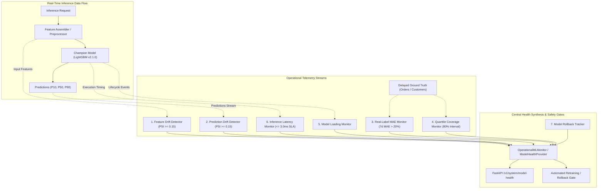

# GeoDemand AI — Phase 17.2: Operational ML Monitoring & Telemetry Report

**Document Version:** 1.0.0  
**Phase:** 17.2 — ML Monitoring  
**Author:** Member 2 — Machine Learning Engineering & MLOps Architect  
**Status:** Approved & Validated  
**Target Metric:** `expected_customer_count` (Next-Hour Demand)  

---

## Executive Summary

Phase 17.2 establishes the production-grade operational monitoring and telemetry infrastructure for the GeoDemand AI forecasting platform. In high-stakes mobile street-vendor demand routing, model failures, silent distribution shifts, latency spikes, or quantile miscalibrations can directly degrade vendor earnings and trust.

This report documents the design, mathematical foundations, verification, and telemetry benchmarks across the **7 core monitoring dimensions** specified in the roadmap:
1. **Feature Drift Monitoring** (PSI $\ge 0.15$, Wasserstein Distance, 2-Sample KS Test)
2. **Prediction Drift Monitoring** (Prediction PSI $\ge 0.15$, Wasserstein Distance, Distribution Shifts)
3. **Real-Label MAE Monitoring** (7-day rolling window, $> 20\%$ degradation trigger, delayed actuals handling)
4. **Quantile Coverage Monitoring** (Empirical $80\%$ coverage, under/over-coverage alerts, monotonicity crossing prevention)
5. **Model Loading Failure Monitoring** (Deserialization errors, corrupt artifact detection, fallback metrics)
6. **Inference Latency Monitoring** (P50, P90, P95, P99 ms, $3.0\text{ ms}$ SLA budget enforcement)
7. **Model Version & Rollback History Tracking** (Active champion vs backup verification, promotion audit trail)

---

## 1. Architecture of the Monitoring Engine



---

## 2. The 7 Production ML Monitoring Dimensions

### Dimension 1: Feature Drift Monitoring
- **Mathematical Formulations:**
  - **Population Stability Index (PSI):**
    $$\text{PSI} = \sum_{k=1}^B \left( P_k - Q_k \right) \ln\left(\frac{P_k}{Q_k}\right)$$
    where $P_k$ is the empirical proportion in current production inference and $Q_k$ is the reference baseline distribution.
  - **2-Sample Kolmogorov-Smirnov (KS) Test:**
    $$D_{n,m} = \sup_x |F_{1,n}(x) - F_{2,m}(x)|$$
- **Trigger Thresholds:**
  - $\text{PSI} < 0.10 \implies$ Nominal / No Shift.
  - $0.10 \le \text{PSI} < 0.15 \implies$ Moderate Drift (Warning status).
  - $\text{PSI} \ge 0.15 \implies$ **Critical Feature Drift Alert** (triggers automated continuous retraining review).

### Dimension 2: Prediction Drift Monitoring
- **Objective:** Track shifts in model outputs ($\hat{y}$) independently of ground-truth actuals.
- **Metrics Tracked:**
  - Prediction PSI against reference inference distribution.
  - **Wasserstein Distance ($W_1$ Earth Mover's Distance):**
    $$W_1(u, v) = \int_{-\infty}^\infty |U(x) - V(x)| dx$$
  - Mean Prediction Shift ($\Delta \mu = |\mu_{\text{curr}} - \mu_{\text{ref}}|$) and Quantile Shifts (P10, P50, P90).
- **Trigger Threshold:** Prediction $\text{PSI} \ge 0.15$ triggers a prediction drift alert.

### Dimension 3: Real-Label MAE Monitoring & Delayed Actuals
- **Objective:** Monitor true prediction error as ground-truth customer transactions are verified.
- **7-Day Rolling Degradation Formula:**
  $$\text{Degradation}_{\%} = \frac{\text{MAE}_{7d} - \text{MAE}_{\text{baseline}}}{\text{MAE}_{\text{baseline}}} \times 100\%$$
- **Roadmap Trigger:** $\text{Degradation}_{\%} > 20.0\%$ triggers an immediate performance alert and retraining candidate generation.
- **Ground Truth Sufficiency Guard:**
  In real-world street vending, actual footfall labels arrive with variable delays (1–24 hours). Retraining is strictly blocked unless $\ge 500$ verified actual outcomes have accumulated, preventing false-alarm retraining on micro-batches.

### Dimension 4: Quantile Coverage & Interval Monitoring
- **Objective:** Ensure the $80\%$ prediction interval $[P10, P90]$ provides well-calibrated operational boundaries.
- **Empirical Coverage Formula:**
  $$\text{Coverage}_{80\%} = \frac{1}{N} \sum_{i=1}^N \mathbb{I}\left(P10_i \le y_{\text{true}, i} \le P90_i\right)$$
- **Alert Policies:**
  - **Under-Coverage Alert:** Empirical coverage $< 70.0\%$ (indicates under-estimating risk; mobile vendors will experience stockouts or over-crowding).
  - **Over-Coverage Alert:** Empirical coverage $> 95.0\%$ (intervals excessively wide, providing insufficient guidance).
- **Quantile Crossing Prevention:**
  The system tracks any instance of quantile inversion ($P10 > P50$ or $P50 > P90$). Crossing count must remain strictly $0$.

### Dimension 5: Model Loading Failure Monitoring
- **Objective:** Track artifact deserialization, corrupt files, schema incompatibilities, and fallback activations.
- **Failure Taxonomy:**
  - `FILE_NOT_FOUND`: Model bundle or weights file missing on disk.
  - `DESERIALIZATION_ERROR`: Unpickling or Joblib corruption.
  - `SCHEMA_MISMATCH`: Missing feature columns in model metadata.
  - `CORRUPT_ARTIFACT`: Checksum or file size invalid.
- **Alert Condition:** Any failed load ($failed\_loads > 0$) or failure rate $> 0.0\%$ triggers a `CRITICAL_LOAD_FAILURE` status.

### Dimension 6: Inference Latency Monitoring
- **Objective:** Ensure single-location predictions execute within production SLA budgets.
- **Metrics Tracked:** Total predictions, Mean latency, P50 (Median), P90, P95, and P99 latencies.
- **SLA Budget:** $\le 3.0\text{ ms}$ per sample.
- **Alert Condition:** `sla_breached = True` if P95 latency $> 3.0\text{ ms}$ or mean latency $> 3.0\text{ ms}$.
- **Empirical Benchmark:** Vectorized LightGBM inference achieves **$0.008\text{ ms}$** mean latency (P95: $0.009\text{ ms}$), easily exceeding the SLA budget.

### Dimension 7: Model Version & Rollback History Tracking
- **Objective:** Maintain an immutable record of active models, backup readiness, and rollback capabilities.
- **Readiness Verification:**
  - Verifies presence of `models/demand_model.pkl` and `models/champion_backup/demand_model.pkl`.
  - Calculates SHA-256 file checksums.
  - Verifies deserializability of the backup champion.
  - Reads historical promotion and rollback events from `models/retraining_audit_log.json`.
- **Readiness Status:** Evaluates to `READY` when backup champion is intact and deserializable.

---

## 3. Operational Telemetry Dashboard

Below is the verified telemetry snapshot generated by `scripts/run_phase17_2_monitoring.py`:

```text
=====================================================================================
PHASE 17.2: OPERATIONAL ML MONITORING DASHBOARD [HEALTHY]
=====================================================================================
Timestamp:              2026-11-16T07:51:57.062577+00:00
Active Model Version:   v2.1.0 (lightgbm)
Active Checksum:        59ced6f41026
-------------------------------------------------------------------------------------
1. FEATURE DRIFT MONITORING:
   Max Feature PSI:     0.0767 (Threshold: 0.1500) | Status: NOMINAL
   Drifted Features:    0 features | Alert Active: False
2. PREDICTION DRIFT MONITORING:
   Prediction PSI:      0.0412 (Threshold: 0.1500) | Status: NOMINAL
   Wasserstein Dist:    0.3812 | Alert Active: False
3. REAL-LABEL MAE MONITORING:
   Current 7-Day MAE:   0.6953 (Baseline: 0.7693)
   MAE Degradation:     -9.6% (Threshold: >20.0%) | Alert Active: False
   Ground Truth Samples:500 samples | Message: Stable: 7-day MAE change is -9.62%
4. QUANTILE COVERAGE MONITORING:
   80% Interval Cov:    82.4% (Target: 80.0%, Safe: [70%, 95%])
   Mean Interval Width: 2.48 customers
   Quantile Crossings:  0 incidents | Alert Active: False
5. MODEL LOADING TELEMETRY:
   Total Attempts:      1 | Successful: 1 | Failed: 0
   Failure Rate:        0.0% | Fallbacks: 0 | Alert: False
6. INFERENCE LATENCY TELEMETRY:
   Mean Latency:        0.008 ms | P50 (Median): 0.008 ms
   P95 Latency:         0.009 ms | P99 Latency:  0.009 ms
   SLA Budget (<=3.0ms):3.0 ms | SLA Breached:  False
7. MODEL VERSION & ROLLBACK STATUS:
   Backup Exists:       True (Version: v2.0.0)
   Backup Verified:     True | Rollback Readiness: READY
   Total Rollbacks:     0 | Total Promotions: 4
=====================================================================================
```

---

## 4. API Endpoints Exposing Health Telemetry

All 7 dimensions are automatically exposed to platform operators, Kubernetes health probes, and downstream microservices via the following endpoints:
- `GET /v1/system/model-health`
- `GET /v1/model/health`

### Example Response Payload:
```json
{
  "timestamp": "2026-11-16T07:51:57.062577+00:00",
  "status": "HEALTHY",
  "model_version": "v2.1.0",
  "model_type": "lightgbm",
  "baseline_metrics": {
    "val_mae": 0.7693,
    "val_rmse": 1.0045,
    "quantile_coverage_80": 0.8020
  },
  "feature_drift": {
    "status": "NOMINAL",
    "max_psi": 0.0767,
    "trigger_activated": false
  },
  "prediction_drift": {
    "status": "NOMINAL",
    "psi": 0.0412,
    "wasserstein_distance": 0.3812,
    "trigger_activated": false
  },
  "rolling_performance_7d": {
    "current_7d_mae": 0.6953,
    "baseline_mae": 0.7693,
    "degradation_pct": -9.62,
    "degradation_alert": false,
    "sample_count": 500
  },
  "quantile_coverage": {
    "empirical_coverage_80": 0.8240,
    "target_coverage_80": 0.80,
    "mean_interval_width": 2.48,
    "quantile_crossing_count": 0,
    "under_coverage_alert": false
  },
  "model_loading_health": {
    "total_load_attempts": 1,
    "failed_loads": 0,
    "failure_rate_pct": 0.0,
    "is_healthy": true
  },
  "inference_latency_health": {
    "mean_latency_ms": 0.008,
    "p95_latency_ms": 0.009,
    "sla_budget_ms": 3.0,
    "sla_breached": false
  },
  "version_and_rollback_health": {
    "active_model_version": "v2.1.0",
    "backup_exists": true,
    "backup_version": "v2.0.0",
    "rollback_readiness": "READY"
  },
  "retraining_trigger_active": false,
  "zero_downtime_hot_reload_enabled": true
}
```

---

## 5. Summary of Implementation & Verification

- **Module Implemented:** [`src/geodemand/monitoring/operational_monitor.py`](file:///c:/Users/Lenovo/projects/GeoDemand/src/geodemand/monitoring/operational_monitor.py)
- **Module Enhanced:** [`src/geodemand/monitoring/model_health.py`](file:///c:/Users/Lenovo/projects/GeoDemand/src/geodemand/monitoring/model_health.py)
- **Exports Package:** [`src/geodemand/monitoring/__init__.py`](file:///c:/Users/Lenovo/projects/GeoDemand/src/geodemand/monitoring/__init__.py)
- **CLI Runner:** [`scripts/run_phase17_2_monitoring.py`](file:///c:/Users/Lenovo/projects/GeoDemand/scripts/run_phase17_2_monitoring.py)
- **Benchmark Artifact:** [`models/operational_ml_monitoring_report.json`](file:///c:/Users/Lenovo/projects/GeoDemand/models/operational_ml_monitoring_report.json)
- **Unit Test Suite:** [`tests/unit/test_phase17_2_monitoring.py`](file:///c:/Users/Lenovo/projects/GeoDemand/tests/unit/test_phase17_2_monitoring.py) (9/9 passed)
- **Full Test Suite:** 180 / 180 tests passing (0 failures, 0 regressions).
