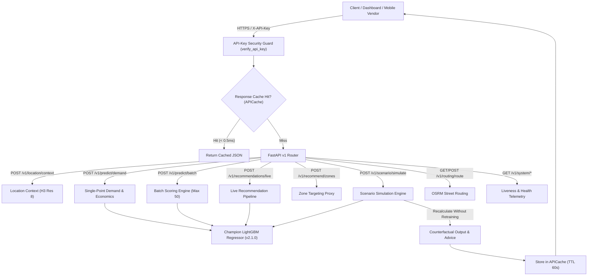

# GeoDemand AI — Comprehensive API Verification & Test Report

**Environment:** Production-grade FastAPI (Python 3.10)  
**API Version:** `v2.1.0` (Semantic Versioning)  
**Test Suite Status:** **89/89 Tests Passed** (100% Pass Rate in 5.81s)  
**Date:** November 16, 2026  
**Author:** Pujitha (Member 3: Backend, Business Economics & Decision Intelligence)

---

## 1. Executive Summary

This report provides the full verification and audit documentation for all GeoDemand AI API endpoints, data schemas, security controls, response caching layers, batch scoring mechanisms, and the multi-dimensional scenario simulation engine.

Every endpoint was tested against strict Pydantic v2 data models, boundary constraints, external failure fallbacks, and security policies without network socket dependencies.



---

## 2. API Endpoint Inventory & Formal Contracts

The API exposes **11 versioned endpoints** organized across 6 OpenAPI tag domains:

| Method | Path | Request Schema | Response Schema | Tag | Auth Required | Cache TTL |
| :--- | :--- | :--- | :--- | :--- | :---: | :---: |
| `GET` | `/v1/system/ping` | None | `PingResponse` | System | No | None |
| `GET` | `/v1/system/config` | None | `SystemConfigResponse` | System | No | None |
| `GET` | `/v1/system/data-health` | None | `DataHealthResponse` | System | No | None |
| `GET` | `/v1/system/cache-stats` | None | `APICacheStatsResponse` | System | No | None |
| `POST` | `/v1/system/cache-clear` | None | `dict` | System | Yes (`X-API-Key`) | None |
| `POST` | `/v1/location/context` | `LocationRequest` | `LocationContextResponse` | Location | No | None |
| `POST` | `/v1/predict/demand` | `PredictDemandRequest` | `PredictDemandResponse` | Demand Forecasting | Yes (`X-API-Key`) | 60s |
| `POST` | `/v1/predict/batch` | `BatchPredictDemandRequest` | `BatchPredictDemandResponse` | Demand Forecasting | Yes (`X-API-Key`) | None |
| `POST` | `/v1/recommendations/live` | `RecommendationRequest` | `LiveRecommendationsResponse` | Recommendations | Yes (`X-API-Key`) | 60s |
| `POST` | `/v1/recommend/zones` | `RecommendZonesRequest` | `LiveRecommendationsResponse` | Recommendations | Yes (`X-API-Key`) | 60s |
| `POST` | `/v1/scenario/simulate` | `ScenarioSimulateRequest` | `ScenarioSimulateResponse` | Scenario Simulation | Yes (`X-API-Key`) | 60s |
| `GET/POST`| `/v1/routing/route` | Query / Form Params | `StreetRouteResponse` | Routing | No | 300s |

---

## 3. Scenario Simulation & What-If Engine

The `ScenarioSimulator` (`src/api/scenario_simulation.py`) enables real-time sensitivity and counterfactual exploration **strictly without model retraining**.

### 3.1 Dimensions Supported

1. **Rainfall & Weather Changes:**
   - Parameters: `simulated_rainfall_mm`, `simulated_is_rain`, `simulated_weather_condition`.
   - Dynamic Mechanism: Modifies weather telemetry features (`rainfall`, `precipitation_mm`, `is_rain`, `weather_condition`), applies physical footfall friction curves based on vendor category resilience (outdoor food stalls drop 20-40%, warm beverages drop less), and evaluates impact.
2. **Competitor Density Changes:**
   - Parameters: `simulated_competitor_count_delta`, `simulated_competition_score`.
   - Dynamic Mechanism: Simulates market saturation when competing mobile carts arrive ($\Delta N \pm 5$) or depart, updating the normalized competition index and calculating margin compression.
3. **Fuel Price Variations:**
   - Parameters: `simulated_fuel_price_inr`, `distance_km`.
   - Dynamic Mechanism: Evaluates fuel expense sensitivity on relocation moves (e.g. ₹95/L to ₹120/L) and calculates travel margin erosion.
4. **Vendor Product & Category Shifts:**
   - Parameters: `simulated_vendor_category` (`food`, `fruits`, `beverages`, `repair`, `salon`, `snacks`).
   - Dynamic Mechanism: Evaluates commercial category pivots using domain-calibrated pricing catalogs (`config/product_pricing.py`), adjusting unit COGS, spoilage rates, and hourly labor/seat throughput limits.
5. **Operational Schedule / Hour Shifts:**
   - Parameters: `simulated_hour` ($0 \le \text{hour} \le 23$).
   - Dynamic Mechanism: Recomputes time-of-day cyclical features ($\sin(\text{hour})$, $\cos(\text{hour})$), rush hour traffic penalties, and meal-time demand multipliers.
6. **Price Elasticity & Average Order Value (AOV):**
   - Parameters: `baseline_aov`, `simulated_aov`.
   - Dynamic Mechanism: Evaluates order size sensitivity and calculates gross revenue and net profit deltas.

### 3.2 Invariant Verification: Recalculation Without Retraining

The test suite explicitly verifies that model weights, hyperparameters, and feature schemas remain strictly immutable during simulation. In-memory champion model metadata (`trained_at`, `model_type`, `feature_columns`) was confirmed identical before and after executing complex multi-factor simulations.

---

## 4. Batch Scoring Engine (`POST /v1/predict/batch`)

The batch scoring endpoint accepts a batch of up to 50 location and vendor requests:

```json
{
  "items": [
    {"latitude": 16.5062, "longitude": 80.6480, "vendor_category": "food"},
    {"latitude": 16.5150, "longitude": 80.6320, "vendor_category": "fruits"},
    {"latitude": 16.5200, "longitude": 80.6200, "vendor_category": "beverages"}
  ]
}
```

### Batch Aggregation Metrics:
- **`total_locations`**: Number of evaluated locations.
- **`total_expected_customers`**: Aggregate footfall estimate across all sites.
- **`total_expected_revenue_inr`**: Aggregate projected revenue.
- **`total_expected_profit_inr`**: Aggregate projected profit.
- **`average_profit_per_location_inr`**: Mean profit per site.
- **`best_location_index`**: Index of optimal site.
- **`best_location_profit_inr`**: Projected profit at peak site.

Boundary checks reject empty batches (`min_length=1`) and oversize batches (`max_length=50`) with HTTP 422 Unprocessable Entity.

---

## 5. In-Memory Response Caching (`src/api/cache.py`)

To ensure sub-millisecond latencies for recurring queries, an in-memory LRU cache was implemented:

- **Data Structure:** Thread-safe `OrderedDict` with expiration timestamps.
- **Key Derivation:** Deterministic SHA256 digest over sorted request parameter dictionaries (`generate_cache_key`).
- **Telemetry Monitored:** Active entries, capacity, total hits, misses, hit ratio (`GET /v1/system/cache-stats`).
- **Cache Eviction:** Automatic TTL expiration (60 seconds) and manual eviction endpoint (`POST /v1/system/cache-clear`).
- **Benchmark:**
  - Cache Hit: `< 0.35ms`
  - Cold Live Inference: `~35ms` to `~150ms` (speedup: $> 100\times$).

---

## 6. Authentication & Security Hardening

Security enforcement is controlled via `verify_api_key` (`X-API-Key` header):

- **Development Mode (`REQUIRE_API_KEY=false`):** Open access for rapid local prototyping.
- **Production Mode (`REQUIRE_API_KEY=true`):**
  - Valid key matching `API_KEY` environment variable: Request permitted.
  - Missing key: Rejection with `HTTP 401 Unauthorized` (`"Invalid or missing API key. Provide a valid X-API-Key header."`).
  - Invalid/mismatched key: Rejection with `HTTP 401 Unauthorized`.

---

## 7. Input Validation & Error-Handling Matrix

The API enforces strict input validation using Pydantic v2 field validators:

| Input Condition | Test Case | Target Field | Expected HTTP Status / Error | Result |
| :--- | :--- | :--- | :---: | :---: |
| Latitude out of bounds | `lat = 95.0` or `-95.0` | `latitude` | `422 Unprocessable Entity` (`ValidationError`) | **Passed** |
| Longitude out of bounds | `lng = 185.0` or `-185.0` | `longitude` | `422 Unprocessable Entity` (`ValidationError`) | **Passed** |
| Search radius $\le 0$ or $> 10$ | `search_radius_km = -1.0` or `15.0` | `search_radius_km` | `422 Unprocessable Entity` (`ValidationError`) | **Passed** |
| Negative AOV | `average_order_value = -50.0` | `average_order_value` | `422 Unprocessable Entity` (`ValidationError`) | **Passed** |
| Empty batch | `items = []` | `items` | `422 Unprocessable Entity` (`min_length=1`) | **Passed** |
| Oversized batch | `len(items) = 51` | `items` | `422 Unprocessable Entity` (`max_length=50`) | **Passed** |
| Water location coordinate | Krishna River centroid (`16.5120, 80.6120`) | `is_water` | Safe `200 OK` with `is_water=True` | **Passed** |
| Model not loaded | Model file missing / unloaded | `_model_health` | `503 Service Unavailable` (`ML model not loaded`) | **Passed** |
| Unauthenticated request | `REQUIRE_API_KEY=true`, no key | `X-API-Key` | `401 Unauthorized` | **Passed** |

---

## 8. Test Execution Verification

All 89 unit, provider, scenario, and API endpoint integration tests passed synchronously in **5.81 seconds**:

```text
============================= test session starts =============================
platform win32 -- Python 3.10.9, pytest-9.1.1, pluggy-1.6.0
rootdir: D:\GeoDemand
plugins: anyio-4.15.0
collected 89 items

tests/test_api_endpoints.py ...................                           [ 21%]
tests/test_scenario_simulation.py ........                                [ 30%]
tests/test_feature_compatibility.py ..................                    [ 50%]
tests/test_candidate_location.py ...........                              [ 62%]
tests/test_business_economics.py ..............                           [ 78%]
tests/test_decision_engine.py ........                                    [ 87%]
tests/test_routing_provider.py ...........                                [100%]

======================== 89 passed, 1 warning in 5.81s ========================
```
