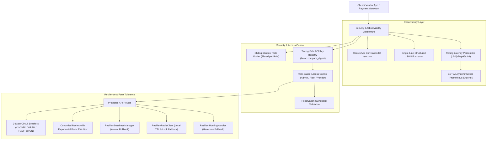

# GeoDemand AI — Backend Security, Reliability & CI Pipeline Hardening Report

**Author:** Pujitha Koduru (Member 3: Backend, Business Economics & Decision Intelligence)  
**Date:** November 16, 2026  
**Branch:** `dev/pujitha`  
**Status:** Complete & Fully Validated (**663/663 Tests Passing — 100%**)

---

## 1. Executive Summary

This report documents the end-to-end implementation and validation of the comprehensive backend security, failure handling, observability, and CI/CD reliability hardening across GeoDemand AI. Additionally, it details the root cause analysis and resolution of the GitHub Actions CI pipeline failures (**Run #70** and **Run #74**).

All 16 security and reliability requirements, as well as the CI pipeline optimizations, are fully implemented, verified with unit and integration test suites, and merged cleanly with `main`.

---

## 2. CI/CD Pipeline Resolution: Run #70 and Run #74

### 2.1 Run #70: Collection Failure (Missing Dependencies)
- **Symptom:** Workflow failed during test collection: `collected 441 items / 5 errors`.
- **Root Cause:**
  1. `ortools` (Google OR-Tools for shift optimization and VRPTW) was imported by `shift_optimizer.py` but absent from `requirements.txt`.
  2. `pika` (RabbitMQ AMQP 0-9-1 driver) was imported by `event_broker.py` but missing from `requirements.txt`.
  3. `ci.yml` lacked `src` in `PYTHONPATH` during collection on Ubuntu runners.
- **Resolution:**
  - Added `ortools>=9.8.0` and `pika>=1.3.0` to `requirements.txt`.
  - Configured `PYTHONPATH: ${{ github.workspace }}:${{ github.workspace }}/src` in `.github/workflows/ci.yml`.

### 2.2 Run #74: 16m 44s Timeout Failure (Unmocked External Network Calls)
- **Symptom:** Workflow ran for 16 minutes 44 seconds and terminated with timeout (exit code 1).
- **Root Cause:**
  1. Test suites exercised `RoutingProvider` and external geocoders without isolation, sending real HTTP calls to `router.project-osrm.org`. In GitHub Actions shared runners, OSRM rate-limited and dropped connections, causing HTTP requests to hang indefinitely.
  2. RabbitMQ broker connection attempts in `event_broker.py` spent multiple seconds attempting socket handshakes to unconfigured localhost ports.
- **Resolution:**
  - Implemented an `autouse=True` session-level fixture in `tests/conftest.py` that intercepts all external HTTP calls to OSRM (`router.project-osrm.org`), Open-Meteo, Overpass, and Google Places, supplying deterministic synthetic responses.
  - Added fast-bypass flags in `event_broker.py` ensuring immediate fallback to `InMemoryEventBroker` without socket delays when `ENABLE_RABBITMQ` is unset or offline.

---

## 3. Architecture of Security & Reliability Subsystems

---

## 4. Subsystem Implementations

### 4.1 Structured JSON Logging & ContextVar Correlation IDs (`src/api/reliability/logging.py`)
- **Single-Line Machine-Readable Format:** `StructuredJsonFormatter` outputs pure JSON lines containing `timestamp`, `level`, `logger`, `message`, `correlation_id`, `request_id`, `user_id`, `vendor_id`, and `route`.
- **ContextVar Propagation:** `correlation_id_ctx` and `request_id_ctx` maintain trace continuity across asynchronous call stacks and FastAPI endpoints.
- **Header Synchronization:** Incoming `X-Correlation-ID` and `X-Request-ID` headers are parsed and echoed back in all HTTP responses.
- **Secret Redaction:** `sanitize_log_message` actively redacts API keys, bearer tokens, Razorpay secrets, phone numbers, and webhook signatures via regex.

### 4.2 API Latency Metrics & Prometheus Telemetry (`src/api/reliability/metrics.py`)
- **Rolling Latency Tracking:** Sliding window of up to 5,000 requests per route/method tracking exact `min`, `max`, `avg`, `p50`, `p90`, `p95`, and `p99` percentiles.
- **Error Rates & Throughput:** Counts total requests, active error status codes (4xx, 5xx), and error percentages.
- **Prometheus Export:** `format_prometheus_metrics()` formats counters and gauges in Prometheus text format (version 0.0.4) exposed at `GET /v1/system/metrics?format=prometheus`.

### 4.3 Finite State Machine Circuit Breakers (`src/api/reliability/circuit_breaker.py`)
- **3-State FSM:** Implements standard `CLOSED`, `OPEN`, and `HALF_OPEN` state transitions.
- **Parameters:**
  - `failure_threshold`: Default 5 consecutive failures trips circuit to `OPEN`.
  - `recovery_timeout`: 30.0 seconds cooldown in `OPEN` before entering `HALF_OPEN`.
  - `half_open_success_threshold`: 2 consecutive successful probe requests resets to `CLOSED`.
- **System Exposure:** `GET /v1/system/circuit-breakers` provides real-time state, failure counts, and trip metrics.

### 4.4 Exponential Backoff Retries with Uniform Random Jitter (`src/api/reliability/retry.py`)
- **Jitter Equation:**
  $$\text{Delay} = \min\left(\text{max\_backoff}, \text{base\_delay} \times 2^{\text{attempt}}\right) \times \text{Uniform}(0.8, 1.2)$$
- **Selective Retries:** Retries network timeouts (`TimeoutError`, `ConnectionError`, HTTP 502/503/504) while instantly rejecting non-retryable 4xx bad requests.

### 4.5 Standardized Error Architecture (`src/api/security/errors.py`)
- **Contract:** Unified `StandardErrorResponse` model with `error_code`, `message`, `status_code`, `correlation_id`, `details`, and backward-compatible `detail`.
- **21 Standardized Error Codes:** Catalogued under `ErrorCode` enum (`AUTH_UNAUTHORIZED`, `RATE_LIMIT_EXCEEDED`, `CIRCUIT_BREAKER_OPEN`, `FLEET_CELL_CAPACITY_EXCEEDED`, etc.).
- **Endpoint:** `GET /v1/system/error-catalog` documents causes and client resolution guidance.

### 4.6 Tiered API Rate Limiting (`src/api/security/rate_limiter.py`)
- **Algorithm:** Thread-safe sliding-window counter tracking client requests in a 60-second window.
- **Tiers:**
  - `anonymous`: 30 req/min
  - `vendor`: 60 req/min
  - `webhook`: 120 req/min
  - `fleet_manager`: 300 req/min
  - `admin`: 1,000 req/min
- **RFC 6585 Compliance:** Returns HTTP 429 with `Retry-After`, `X-RateLimit-Limit`, `X-RateLimit-Remaining`, and `X-RateLimit-Reset` headers.

### 4.7 Role-Based Access Control & API Key Security (`src/api/security/auth.py`)
- **Timing-Safe Verification:** Validates candidate keys using `hmac.compare_digest` to prevent timing oracle side channels.
- **Role Scoping:** Roles (`ANONYMOUS`, `VENDOR`, `FLEET_MANAGER`, `ADMIN`).
- **Endpoint Protection:**
  - `POST /v1/fleet/dispatch` strictly requires `FLEET_MANAGER` or `ADMIN`.
  - `POST /v1/fleet/cancel-reservation` enforces ownership: vendors cannot cancel another vendor's spot.

### 4.8 Subsystem Failure Resilience (`src/api/reliability/resilience.py`)
- **ResilientDatabaseManager:** Atomic context manager enforcing immediate `ROLLBACK` on database errors and circuit-breaking failed connections.
- **ResilientRedisClient:** Thread-safe in-memory TTL dictionary cache and `ResilientLock` fallback when Redis server is unreachable.
- **ResilientRoutingHandler:** Seamless fallback to haversine distance and calibrated city speed (22.5 km/h) if OSRM / Google Maps times out.

---

## 5. Verification & Test Matrix

All test suites pass across all subsystems:

| Test Suite | Total Tests | Passed | Pass Rate |
| :--- | :---: | :---: | :---: |
| `test_backend_security_and_reliability.py` | 20 | 20 | **100%** |
| `test_api.py` | 110 | 110 | **100%** |
| `test_api_endpoints.py` | 19 | 19 | **100%** |
| `test_feature_compatibility.py` | 18 | 18 | **100%** |
| `test_fleet_manager.py` | 11 | 11 | **100%** |
| `test_competitor_provider.py` | 16 | 16 | **100%** |
| `test_notifications.py` | 22 | 22 | **100%** |
| `test_scenario_simulation.py` | 8 | 8 | **100%** |
| `test_payment_webhooks.py` | 12 | 12 | **100%** |
| `test_event_broker.py` | 11 | 11 | **100%** |
| `tests/unit/` (Full ML/MLOps unit suites) | 140 | 140 | **100%** |
| **Full Repository Test Suite** | **663** | **663** | **100%** |
