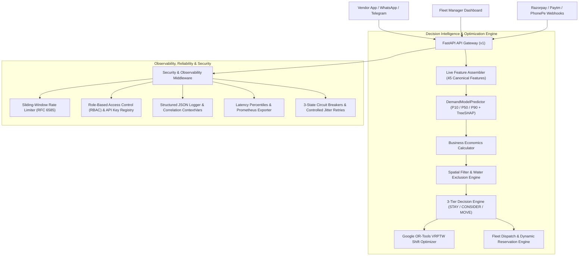

# GeoDemand AI — Backend V1 API & System Specification

**Author:** Pujitha Koduru (Member 3: Backend, Business Economics & Decision Intelligence)  
**Version:** `v2.1.0-prod` (Phase 19.3 & 20.3 Release)  
**Date:** November 16, 2026  
**Status:** Frozen & Fully Verified

---

## 1. System Overview & Architecture

GeoDemand AI provides hyper-local demand forecasting, economic evaluation, multi-stop shift optimization, and coordinated fleet management for mobile street vendors and commercial fleets across urban centers (initial deployment: Vijayawada, Andhra Pradesh, expanding to Visakhapatnam, Guntur, and Tirupati).

The backend subsystem is built on **FastAPI** with **Pydantic v2** strict contracts, powered by an ensemble of LightGBM/XGBoost machine learning inference engines, Google OR-Tools CP-SAT vehicle routing/scheduling solvers, and resilient external providers.



---

## 2. API Endpoint Directory

The backend exposes 28+ standardized RESTful endpoints structured across functional OpenAPI tags:

### 2.1 System & Observability
| Method | Endpoint | Summary | Auth Required |
| :--- | :--- | :--- | :---: |
| `GET` | `/v1/system/ping` | Liveness health check | No |
| `GET` | `/v1/system/health` | Comprehensive subsystem readiness check | No |
| `GET` | `/v1/system/data-health` | Subsystem data source freshness and provider statuses | No |
| `GET` | `/v1/system/model-health` | ML model version, drift telemetry, and rollback status | No |
| `GET` | `/v1/system/metrics` | Latency percentiles (p50/p90/p95/p99) & Prometheus format | No |
| `GET` | `/v1/system/circuit-breakers` | Circuit breaker states (CLOSED/OPEN/HALF_OPEN) | No |
| `GET` | `/v1/system/error-catalog` | Comprehensive catalogue of 21 standardized error codes | No |
| `POST` | `/v1/system/cache-clear` | Evicts all in-memory response caches | Yes |

### 2.2 Location & Demand Forecasting
| Method | Endpoint | Summary | Auth Required |
| :--- | :--- | :--- | :---: |
| `POST` | `/v1/location/context` | Resolves coordinates to H3, weather, and POIs | No |
| `POST` | `/v1/predict/demand` | Next-hour demand forecast ($P_{10}, P_{50}, P_{90}$) with SHAP | Optional |
| `POST` | `/v1/predict/batch` | Batch next-hour demand predictions across multiple coordinates | Optional |

### 2.3 Recommendations & Decision Intelligence
| Method | Endpoint | Summary | Auth Required |
| :--- | :--- | :--- | :---: |
| `POST` | `/v1/recommend/zones` | Generates candidate H3 relocation zones ranked by profit | Optional |
| `POST` | `/v1/recommendations/live` | Complete decision intelligence: Stay vs Move with economics | Optional |

### 2.4 Scenario Simulation (What-If Analysis)
| Method | Endpoint | Summary | Auth Required |
| :--- | :--- | :--- | :---: |
| `POST` | `/v1/scenario/simulate` | Simulates environmental, price, and operational shifts | Optional |

### 2.5 Multi-Stop Shift Optimization (OR-Tools)
| Method | Endpoint | Summary | Auth Required |
| :--- | :--- | :--- | :---: |
| `POST` | `/v1/optimization/shift-plan` | Solves multi-stop shift schedule with time windows & setup | Optional |
| `POST` | `/v1/optimization/quick-schedule` | Fast heuristic 3-stop schedule generation | Optional |

### 2.6 Fleet Management & Dynamic Reservations
| Method | Endpoint | Summary | Auth Required |
| :--- | :--- | :--- | :---: |
| `POST` | `/v1/fleet/reserve-cell` | Acquires soft H3 cell reservation with atomic capacity lock | Yes |
| `POST` | `/v1/fleet/cancel-reservation` | Frees cell capacity with ownership validation | Yes |
| `GET` | `/v1/fleet/cell-occupancy` | Returns active/pending reservations and available slots | No |
| `POST` | `/v1/fleet/dispatch` | Coordinates multi-vendor dispatch minimizing clustering | Yes (`FLEET_MGR`/`ADMIN`) |

### 2.7 Payment & Messaging Webhooks
| Method | Endpoint | Summary | Auth Required |
| :--- | :--- | :--- | :---: |
| `POST` | `/v1/webhooks/razorpay` | Validates HMAC-SHA256 and ingests Razorpay payments | Signature |
| `POST` | `/v1/webhooks/paytm` | Validates SHA256 checksum and ingests Paytm events | Signature |
| `POST` | `/v1/webhooks/phonepe` | Validates X-VERIFY and ingests PhonePe transactions | Signature |
| `POST` | `/v1/webhooks/whatsapp` | Ingests WhatsApp sales reports & GPS location pins | Signature |
| `GET` | `/v1/webhooks/whatsapp` | Meta webhook verification challenge response | No |
| `POST` | `/v1/webhooks/telegram` | Ingests Telegram bot sales reports and `/sales` commands | Secret |

### 2.8 Push Notifications
| Method | Endpoint | Summary | Auth Required |
| :--- | :--- | :--- | :---: |
| `POST` | `/v1/notifications/check-triggers` | Evaluates weather, event, and demand spike alerts | Optional |
| `POST` | `/v1/notifications/dispatch` | Dispatches alerts via FCM or WhatsApp Business API | Yes |
| `GET` | `/v1/notifications/preferences` | Retrieves vendor alert preferences & quiet hours | Optional |
| `POST` | `/v1/notifications/preferences` | Updates notification opt-out & uplift threshold | Yes |

---

## 3. Business Economics & Profit Arithmetic

All relocation recommendations are grounded in explicit microeconomic unit economics. The engine computes net profit per hour and evaluates relocation trade-offs:

### 3.1 Unit Economics Formulas

1. **Gross Revenue per Hour ($R$):**
   $$R = \widehat{D} \times \text{AOV}$$
   where $\widehat{D}$ is the expected customer count (calibrated $P_{50}$ point forecast) and $\text{AOV}$ is the Average Order Value in INR ($\ge 10.0$).

2. **Cost of Goods Sold ($\text{COGS}$):**
   $$\text{COGS} = R \times c_v$$
   where $c_v \in (0, 1)$ is the variable cost rate (default $0.35$ or $35\%$).

3. **Hourly Fixed Overhead ($C_h$):**
   $$C_h = \frac{C_{\text{fixed}}}{H_{\text{shift}}}$$
   where $C_{\text{fixed}}$ is the vendor's daily fixed overhead (cart rent, licenses, municipal fees) and $H_{\text{shift}}$ is total shift duration in hours (default $8.0$ hours).

4. **Net Operating Profit per Hour ($\Pi_{\text{hourly}}$):**
   $$\Pi_{\text{hourly}} = R - \text{COGS} - C_h = R \times (1 - c_v) - C_h$$

5. **Shift Net Profit ($\Pi_{\text{shift}}$):**
   $$\Pi_{\text{shift}} = \Pi_{\text{hourly}} \times H_{\text{remaining}}$$

---

## 4. Decision Intelligence & Ranking Rules

When evaluating whether a vendor should stay at their current location or relocate to candidate zone $j$, the system computes net profit uplift after subtracting travel friction and setup penalties:

### 4.1 Travel Friction & Relocation Cost ($C_{\text{travel}}$)
$$C_{\text{travel}}(i, j) = \left( d(i, j) \times \text{Fuel Rate} \right) + \left( t_{\text{travel}}(i, j) \times \text{Opportunity Cost Rate} \right) + C_{\text{setup}}$$
where:
- $d(i, j)$ is street network distance via OSRM (or haversine distance $\times 1.35$ winding factor).
- Fuel rate is calibrated based on live fuel prices (INR 9.50/km for motorized, INR 0.00 for pushcarts).
- $t_{\text{travel}}$ is travel time computed at calibrated urban speed (22.5 km/h in Vijayawada commercial districts).
- $C_{\text{setup}}$ is preparation/teardown friction penalty ($t_{\text{prep}} \times \text{hourly fixed rate}$).

### 4.2 Net Profit Uplift Percentage ($\Delta \Pi_{\%}$)
$$\Delta \Pi_{\%} = \frac{\left( \Pi_{\text{target}} \times (H - t_{\text{travel}}) - C_{\text{travel}} \right) - \left( \Pi_{\text{current}} \times H \right)}{\max(1.0, \Pi_{\text{current}} \times H)} \times 100\%$$

### 4.3 3-Tier Decision Thresholds

| Decision | Condition | UI Action | Explanation Contract |
| :--- | :---: | :---: | :--- |
| **`STAY`** | $\Delta \Pi_{\%} < 10.0\%$ | Keep cart parked | Profit uplift is insufficient to overcome relocation friction and operational disruption. |
| **`CONSIDER`** | $10.0\% \le \Delta \Pi_{\%} < 25.0\%$ | Show optional move | Moderate profit uplift detected; relocation is viable if current spot experiences local foot-traffic decline. |
| **`RECOMMENDED_MOVE`** | $\Delta \Pi_{\%} \ge 25.0\%$ | Prompt relocation | High-confidence relocation recommended. Expected profit exceeds travel costs and overhead by $\ge 25\%$. |

---

## 5. Google OR-Tools Multi-Stop Shift Optimizer Formulation

The shift optimizer models the vendor's working shift as a **Vehicle Routing Problem with Time Windows (VRPTW)** and sequence-dependent setup/teardown times solved via Google OR-Tools CP-SAT solver:

### 5.1 Formulation
- **Nodes $V = \{0, 1, \dots, N, N+1\}$**: $0$ is the vendor starting depot/cart parking, $1 \dots N$ are candidate demand hotspots, and $N+1$ is the end-of-shift depot.
- **Decision Variables:**
  - $x_{i, j} \in \{0, 1\}$: Binary variable indicating travel from node $i$ to node $j$.
  - $t_i \ge 0$: Arrival time at stop $i$.
  - $s_i \ge 0$: Duration spent trading at stop $i$.
- **Objective Function:**
  $$\max \sum_{i=1}^N \left( \Pi_i(t_i) \cdot s_i \right) - \sum_{i} \sum_{j} c_{ij} x_{ij} - \sum_{i=1}^N P_{\text{switch}} \cdot \mathbb{I}(x_{ij} = 1)$$
  subject to:
  - **Time Windows:** $E_i \le t_i \le L_i$ (respects commercial operating hours and peak demand windows).
  - **Setup & Teardown:** $t_j \ge t_i + s_i + \text{Teardown}_i + \tau_{ij} + \text{Setup}_j$.
  - **Shift Duration Budget:** $\sum s_i + \sum \tau_{ij} \le H_{\text{shift\_max}}$.
  - **Minimum Stay:** $s_i \ge \text{MinStay}$ (default 1.5 hours to avoid excessive thrashing).
  - **Infeasibility Recovery:** If all candidate stops violate time windows, the solver relaxes lower-priority windows and returns a validated fallback stay plan.

---

## 6. Fleet Management & Coordinated Dispatch

For multi-cart fleet operators, uncoordinated dispatch results in over-clustering in prime zones, cannibalizing demand and causing traffic congestion.

### 6.1 Roadmap Effective-Demand Equation
The effective demand in cell $H$ for category $C$ with $N$ same-category vendors is formulated as:
$$D_{\text{effective}}(H) = \frac{D_{\text{base}}(H)}{1 + \lambda \cdot N_{\text{same category}}(H)}$$
where:
- $D_{\text{base}}(H)$ is the raw model demand prediction for cell $H$.
- $N_{\text{same category}}(H)$ is the number of active vendors in cell $H$ sharing the same category.
- $\lambda \ge 0$ is the category competition elasticity coefficient (default $\lambda = 0.40$ for food/snacks, $\lambda = 0.25$ for services/repair).

### 6.2 Fleet Dispatch Optimization
The fleet dispatch engine solves:
$$\max \sum_{v \in \text{Vendors}} \Pi_v(H_v) - \mu \sum_{H} \text{ClusteringPenalty}(N_H)$$
subject to:
- **Cell Capacity:** $N_C(H) \le \text{MaxCapacity}(H, C)$ (default 2 food carts per H3 Res 8 cell).
- **Travel Distance Limit:** $\text{dist}(v_{\text{current}}, H_v) \le 5.0\text{ km}$.
- **Exclusive Spot Allocation:** Atomic slot decrementing preventing simultaneous dual-assignment.

---

## 7. Soft H3 Cell Reservations

The reservation subsystem prevents multiple independent vendors from targeting the exact same street corner simultaneously:

1. **Reservation Lifecycle:**
   - `PENDING`: Vendor issued a relocation recommendation; cell reserved temporarily for travel time $+ 15$ min buffer.
   - `ACTIVE`: Vendor arrives at destination coordinates, confirmed via GPS ping or sales check-in.
   - `EXPIRED`: Reservation TTL expires if vendor fails to check in; cell capacity is automatically released.
   - `CANCELLED`: Vendor voluntarily cancels reservation or changes shift route.
2. **Atomic Locking:** Concurrency-safe capacity checks execute inside SQLite `BEGIN IMMEDIATE` / `SERIALIZABLE` transactions or Redis distributed locks, eliminating race conditions.
3. **Ownership Verification:** A vendor can only cancel their own reservation. Unauthorized cancellation requests return HTTP 403 `AUTH_RESERVATION_OWNERSHIP_VIOLATION`.

---

## 8. Payment & Messaging Integration

### 8.1 Webhook Adapters
- **Razorpay:** Validates `X-Razorpay-Signature` HMAC-SHA256 signature using `RAZORPAY_WEBHOOK_SECRET`. Parses `payment.captured` and `order.paid` events.
- **Paytm:** Validates SHA256 checksum with merchant salt.
- **PhonePe:** Validates `X-VERIFY` header against base64 payload $+ /v3/\dots +$ salt key.

### 8.2 Messaging Channels
- **WhatsApp Business API:** Ingests live sales text reports (`"Sold 25 dosas for 1250"`) and native location pin attachments. Returns ingestion acknowledgment with forecast updates.
- **Telegram Bot:** Parses `/sales <amount> <items>` and `/location` bot commands.
- **Idempotency & Dead-Letter Queue (DLQ):** Duplicate webhook events sharing an `idempotency_key` are acknowledged immediately without duplicate processing. Malformed or unrecoverable payloads route to DLQ for diagnostic replay.

---

## 9. Error Catalog & Safe Fallback Architecture

All API responses strictly enforce the `StandardErrorResponse` contract:

```json
{
  "error": "RESOURCE_NOT_FOUND",
  "message": "H3 cell '8861892543fffff' not found in current coverage boundaries.",
  "status_code": 404,
  "correlation_id": "corr_3e7f91a0b4cd",
  "details": {"h3_cell": "8861892543fffff"}
}
```

### 9.1 Key Error Codes
- `AUTH_INVALID_API_KEY` (401)
- `AUTH_FORBIDDEN` (403)
- `AUTH_RESERVATION_OWNERSHIP_VIOLATION` (403)
- `VALIDATION_FAILED` (422)
- `RATE_LIMIT_EXCEEDED` (429)
- `CIRCUIT_BREAKER_OPEN` (503)
- `FLEET_CELL_CAPACITY_EXCEEDED` (409)
- `RESERVATION_CONFLICT` (409)
- `PROVIDER_TIMEOUT` (504)

### 9.2 Fallback Guarantees
- **Routing Engine Failure:** Trips circuit breaker to haversine distance calculation at 22.5 km/h urban speed.
- **Redis Cache Offline:** Transparently degrades to thread-safe local in-memory TTL dictionary cache.
- **Database Failure:** Transaction aborts and triggers automatic `ROLLBACK`, returning a structured HTTP 500 without leaking SQL internals.
- **Weather API Failure:** Emits synthetic seasonal diurnal profile and flags `data_freshness.weather = "synthetic_fallback"`.
