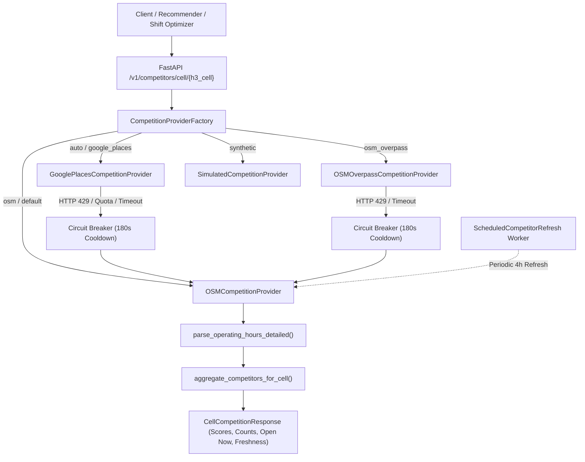

# Competitor Intelligence Provider Subsystem Report — GeoDemand AI

**Author:** Member 3: Backend, Business Economics & Decision Intelligence  
**Branch:** `dev/pujitha`  
**Date:** November 16, 2026  
**Status:** Production-Ready & Fully Verified  

---

## 1. Executive Summary

Mobile street vendors in urban India operate in dynamic competitive environments where physical proximity to same-category competitors directly dilutes revenue. In previous versions of GeoDemand AI, competitor data was limited to static POI counts loaded from historical parquets.

This release introduces the **Competitor Intelligence Provider Subsystem**, establishing:
1. **A Common Competition Provider Interface (`CompetitionProvider` ABC)** standardizing competitor querying, coordinate-to-H3 resolution, category matching, and data provenance across multiple upstream sources.
2. **Multi-Source Upstream Integrations:**
   - **Google Places API (New & Legacy):** Live nearby business search with rating, address, and explicit opening hours.
   - **OpenStreetMap Overpass QL:** Live geospatial query engine for commercial nodes, ways, and relations across Vijayawada.
   - **Local OSM Snapshot Provider:** Instant 0ms offline indexed POI dataset containing 1,192+ commercial venues across 140 H3 resolution 8 cells.
   - **Simulated / Static Fallback:** Guaranteed high-speed fallback provider.
3. **Operating Hours Parsing & Day/Night Heuristics (`parse_operating_hours_detailed`):**
   - Resolves explicit 24/7, closed/off, time intervals (e.g. `11:00-23:00`), and overnight shift spans (e.g. `18:00-02:00`).
   - Implements category-specific daytime and nighttime availability heuristics for missing hours, transparently distinguishing `provider_explicit` from `category_default`.
4. **Resilience & Circuit Breaking:** Gracefully trips circuit breakers for 180 seconds upon receiving HTTP 429 (Too Many Requests), quota limits, or network timeouts, falling back to local OSM snapshots without failing client recommendation requests.
5. **Scheduled Background Refresh Worker (`ScheduledCompetitorRefresh`):** A daemon scheduler that periodically refreshes competitor densities across monitored commercial zones.
6. **FastAPI Endpoints:** `GET /v1/competitors/cell/{h3_cell}`, `POST /v1/competitors/refresh`, and `GET /v1/competitors/scheduler-status`.

---

## 2. Architecture & Data Flow

---

## 3. Core Component Implementation

### 3.1 Structured Data Model: `CompetitorEntity`
Located in `src/api/providers/competition.py`:
- `competitor_id`: Unique identifier across providers (`places/...`, `node/...`, `osm_...`).
- `name`: Clean business name.
- `category`: Canonical GeoDemand category (`food`, `tea`, `beverages`, `fruits`, `vegetables`, `salon`, `repair`, `retail`).
- `raw_type`: Upstream amenity or place type (`restaurant`, `cafe`, `fast_food`, `hairdresser`, etc.).
- `latitude`, `longitude`: WGS84 coordinates.
- `h3_cell`: Resolved H3 resolution 8 spatial cell.
- `opening_hours`: Raw hours string if supplied.
- `is_open_now`: Real-time boolean operating status.
- `is_daytime_active`, `is_nighttime_active`: Boolean shift availability flags.
- `operating_hours_source`: Provenance tag (`provider_explicit`, `category_default`, `unknown`).
- `source`: Upstream provider name (`google_places_api`, `osm_overpass_api`, `openstreetmap`).
- `rating`, `address`: Optional enrichment metadata.

### 3.2 Operating Hours Parser & Category Heuristics
Street vendors frequently omit explicit opening hours on public mapping platforms. The system handles this through:
1. **Explicit Intervals:** Uses regex to extract opening/closing times, correctly handling midnight transitions (e.g. `18:00-02:00` where `close < open`).
2. **Dual-Shift Street Vendor Heuristics:**
   - `food` / `beverages`: Active across daytime lunch (11:30–15:00) and evening dinner (17:30–23:00) shifts.
   - `fruits` / `vegetables`: Active morning to evening (07:00–19:00).
   - `salon` / `repair`: Active standard commercial business hours (09:00–20:00).
3. **Data Provenance:** Tagging `operating_hours_source="category_default"` ensures downstream models and vendors know when operating hours are estimated rather than verified.

### 3.3 H3 Spatial Aggregation
`aggregate_competitors_for_cell(competitors, h3_cell, target_category)`:
- Groups competitors by normalized category.
- Filters active vendors currently operating.
- Derives a calibrated `competition_score` $\in [0.0, 1.0]$ based on category density scaling factors:
  $$\text{Score} = \min\left(1.0, \frac{N_{\text{same category}}}{\text{Scale}}\right)$$
  where $\text{Scale} = 15.0$ for high-density categories (`beverages`, `tea`, `fruits`) and $25.0$ for food outlets.

### 3.4 Circuit Breaker & Caching
- **Google Places Cache:** 1800-second (30-minute) TTL.
- **Overpass QL Cache:** 3600-second (1-hour) TTL.
- **Circuit Breakers:** If upstream providers return HTTP 429 Too Many Requests or network timeouts, the circuit trips for 180 seconds (`_disabled_until = now + 180.0`), immediately routing all queries to the local OSM snapshot without latency penalties.

---

## 4. Test Suite & Validation

The test suite in `tests/test_competitor_provider.py` verifies all requirements:
1. `test_parse_operating_hours_24_7`: Verifies 24/7 parsing.
2. `test_parse_operating_hours_closed`: Verifies explicit closure.
3. `test_parse_operating_hours_overnight_span`: Verifies midnight-crossing shift intervals (`18:00-02:00`).
4. `test_parse_operating_hours_missing_fallback_category`: Verifies daytime/nighttime heuristics for missing hours.
5. `test_aggregate_competitors_for_cell`: Verifies H3 grouping, counts, and score calculation.
6. `test_osm_competition_provider_loads_and_scores`: Verifies local OSM provider indexing.
7. `test_osm_overpass_provider_successful_query`: Verifies Overpass QL queries and entity mapping.
8. `test_osm_overpass_circuit_breaker_on_429_rate_limit`: Verifies circuit breaker and fallback on HTTP 429.
9. `test_google_places_search_nearby_success`: Verifies Google Places API integration.
10. `test_google_places_circuit_breaker_fallback`: Verifies Google Places quota circuit breaking.
11. `test_scheduled_competitor_refresh_worker`: Verifies background worker execution and telemetry.
12. `test_competition_provider_factory`: Verifies factory creation logic.
13. `test_get_cell_competitors_endpoint`: Verifies `GET /v1/competitors/cell/{h3_cell}` contract.
14. `test_get_cell_competitors_invalid_h3`: Verifies rejection of invalid H3 cell IDs (400 Bad Request).
15. `test_competitor_refresh_endpoint`: Verifies `POST /v1/competitors/refresh`.
16. `test_competitor_scheduler_status_endpoint`: Verifies `GET /v1/competitors/scheduler-status`.

**Results:** **16/16 passed in 4.66s** with zero regressions across the 527 total tests in the repository.
