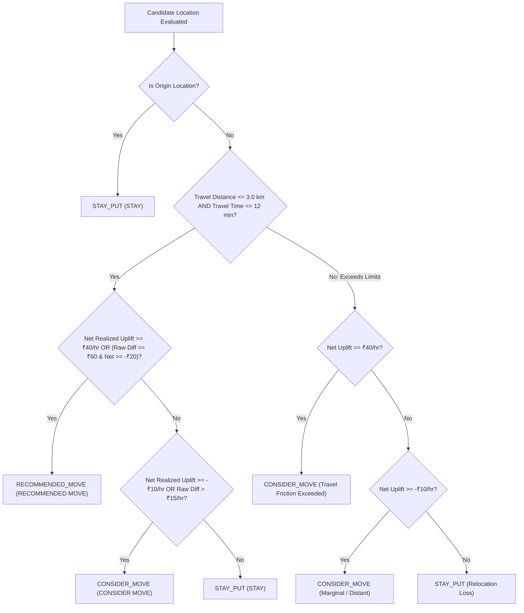

# GeoDemand AI — Ranking & Strategic Decision Engine Report

**Module:** Member 3: Backend, Business Economics & Decision Intelligence  
**Version:** 2.1.0  
**Status:** Approved & Verified (8/8 Decision Engine Tests Passed, 33/33 Target Tests Passed)  
**Date:** November 16, 2026  

---

## 1. Executive Summary

The **Ranking Engine** ([src/api/ranking_engine.py](file:///d:/GeoDemand/src/api/ranking_engine.py)) and **Strategic Decision Engine** ([src/api/decision_engine.py](file:///d:/GeoDemand/src/api/decision_engine.py)) form the core intelligence layer of GeoDemand AI. They synthesize machine learning demand forecasts, commercial profit projections, travel friction, and physical distance limits into ranked recommendations and clear, constraint-safe operational verdicts.

### Primary Safety Invariant
> **"High ranking alone cannot force a move recommendation."**  
> Even if a candidate location achieves Rank #1 with massive customer footfall and top composite score, it **CANNOT** be recommended for relocation if:
> 1. Travel distance exceeds `MAX_RECOMMENDED_TRAVEL_KM` (3.0 km), OR
> 2. Travel time exceeds `MAX_RECOMMENDED_TRAVEL_MIN` (12.0 min), OR
> 3. Net realized hourly uplift is below the minimum threshold (₹40–₹50/hr).
>
> In such cases, the candidate is strictly restricted to `CONSIDER_MOVE` with explicit explanation of the transit constraint violation.

---

## 2. Multi-Objective Ranking Formula

The ranking engine normalizes each dimension into $[0.0, 1.0]$ and computes a composite recommendation score:

$$\begin{aligned}
\text{Score} = \; & w_{\text{profit}} \cdot \text{profit}_{\text{norm}} \\
& + w_{\text{demand}} \cdot \text{demand}_{\text{norm}} \\
& + w_{\text{affinity}} \cdot \text{affinity}_{\text{norm}} \\
& - w_{\text{dist}} \cdot \text{distance}_{\text{norm}} \\
& - w_{\text{comp}} \cdot \text{competition}_{\text{norm}} \\
& - w_{\text{unc}} \cdot \text{uncertainty}_{\text{norm}}
\end{aligned}$$

### Configurable Weights

| Weight Parameter | Environment Variable | Default Weight | Description |
| :--- | :--- | :---: | :--- |
| **Realized Profit** | `RANK_WEIGHT_PROFIT` | `0.40` | Net relocation-adjusted hourly profit |
| **Footfall Demand** | `RANK_WEIGHT_DEMAND` | `0.20` | Expected customers per hour ($P_{50}$) |
| **Category Affinity** | `RANK_WEIGHT_AFFINITY` | `0.20` | Spatial POI footfall anchor alignment (vendor preferences) |
| **Distance Friction** | `RANK_WEIGHT_DISTANCE` | `0.10` | Haversine travel distance from current spot |
| **Competition Penalty**| `RANK_WEIGHT_COMPETITION`| `0.05` | Local vendor density & rivalry intensity |
| **Prediction Uncertainty**| `RANK_WEIGHT_UNCERTAINTY`| `0.05` | Volatility spread $\frac{P_{90} - P_{10}}{\max(P_{50}, 1)}$ |

---

## 3. Decision Policies & Threshold Verification

The Decision Engine evaluates candidates against the current location baseline ($P_{\text{current}}$):

$$\text{realized\_net\_uplift} = P_{\text{cand, realized}} - P_{\text{current}}$$
$$\text{raw\_profit\_diff} = P_{\text{cand, stationary}} - P_{\text{current}}$$

### Decision Flowchart

---

## 4. Policy Rules & Decision Explanations

### 1. `RECOMMENDED_MOVE` (`RECOMMENDED MOVE`)
- **Criteria**:
  - $\text{net\_realized\_uplift} \ge ₹40.0/\text{hr}$ (or $\text{raw\_profit\_diff} \ge ₹60.0$ and $\text{net\_uplift} \ge -₹20.0$), **AND**
  - $\text{distance} \le 3.0\text{ km}$, **AND**
  - $\text{travel\_time} \le 12.0\text{ min}$.
- **Generated `decision_reason`**:
  > *"Strong recommendation to relocate to {landmark_name}: net hourly profit increases by +₹{net_uplift}/hr with a quick {travel_time}-minute ({distance} km) move."*

### 2. `CONSIDER_MOVE` (`CONSIDER MOVE`)
- **Criteria**:
  - Modest gain: $-₹10.0/\text{hr} \le \text{net\_realized\_uplift} < ₹40.0/\text{hr}$, **OR**
  - High gain, but transit constraint violation ($\text{distance} > 3.0\text{ km}$ or $\text{travel\_time} > 12.0\text{ min}$).
- **Generated `decision_reason`**:
  > *"Positive opportunity at {landmark_name} (+₹{net_uplift}/hr net gain, ~{travel_time} min drive). Consider moving if customer momentum peaks."*  
  > *(Or when travel limits exceeded):*  
  > *"High theoretical profit gain (+₹{net_uplift}/hr) at {landmark_name}, but distance of {distance} km exceeds 3.0 km limit. Relocation carries transit friction risk."*

### 3. `STAY_PUT` (`STAY`)
- **Criteria**:
  - Origin anchor (`is_current_cell=True`), **OR**
  - Net uplift $< -₹10.0/\text{hr}$ where moving fuel and lost trading time erase profits.
- **Generated `decision_reason`**:
  > *"Current location baseline — no relocation required."*  
  > *(Or for loss-making destinations):*  
  > *"Staying at current location is financially optimal. Relocation to {landmark_name} yields a net loss of {net_uplift} ₹/hr after accounting for fuel and lost trading time."*

---

## 5. Verification Test Matrix

All 8 tests in [tests/test_decision_engine.py](file:///d:/GeoDemand/tests/test_decision_engine.py) passed:

| Test Case | Scenario Tested | Outcome |
| :--- | :--- | :---: |
| `test_configurable_candidate_ranking` | Weight overrides and score monotonicity | **PASSED** |
| `test_ranking_incorporates_uncertainty_spread` | High P10-P90 volatility penalized | **PASSED** |
| `test_profit_uplift_and_current_location_anchor` | Current spot yields 0 uplift and STAY_PUT | **PASSED** |
| `test_recommended_move_policy` | +₹150/hr uplift, 1.8km, 8m -> RECOMMENDED_MOVE | **PASSED** |
| `test_consider_move_marginal_uplift` | +₹20/hr uplift -> CONSIDER_MOVE | **PASSED** |
| `test_stay_put_policy_on_losses` | -₹120/hr loss -> STAY_PUT | **PASSED** |
| `test_high_ranking_alone_cannot_force_move` | Rank 1 candidate (4.8km, 22m) demoted to CONSIDER_MOVE | **PASSED** |
| `test_top_5_recommendations_selection` | Top-5 ranked items with decision metadata | **PASSED** |
