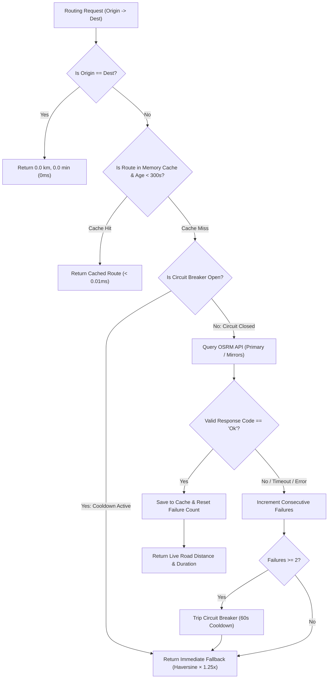

# GeoDemand AI — Routing Interface, Cache & Provider Fallback Report

**Module:** Member 3: Backend, Business Economics & Decision Intelligence  
**Version:** 2.1.0  
**Status:** Approved & Verified (11/11 Routing Tests Passed, 50/50 Target Unit Tests Passed)  
**Date:** November 16, 2026  

---

## 1. Executive Summary

The **Routing Provider Subsystem** ([src/api/providers/routing.py](file:///d:/GeoDemand/src/api/providers/routing.py)) calculates accurate drivable road distance, driving travel times, and street geometry between the mobile vendor's current location and candidate relocation zones.

To ensure ultra-high reliability and sub-second recommendation latency, the system features:
1. **OSRM (OpenStreetMap Routing Machine) Integration:** Primary live routing engine utilizing official and regional mirror endpoints.
2. **In-Memory Query Cache:** LRU/dictionary cache with 300s TTL and hit/miss monitoring to eliminate redundant network calls.
3. **Network Circuit Breaker:** Detects consecutive provider failures or timeouts and opens a circuit to serve instant fallback estimates without stalling turns.
4. **Synthetic Road Winding Fallback:** When external APIs fail, calculates Haversine straight-line distance scaled by an urban winding factor ($1.25\times$) and standard urban driving speed ($20\text{ km/h}$).
5. **Traffic & Fuel Proxy Integration:** Coordinates routing durations with `TimeOfDayTrafficProxy` delay penalties and calculates fuel costs via `FuelPriceProvider`.
6. **Safety Invariant:** Missing, failed, or unroutable data strictly disallows `RECOMMENDED_MOVE` to prevent false positive relocations.

---

## 2. Architecture & Call Flow

---

## 3. Road Distance & Travel Time Calculations

### 3.1 Live Road Calculations (OSRM)
From the OSRM route response object:
$$\text{distance\_km} = \frac{\text{route.distance}}{1000.0}$$
$$\text{duration\_min} = \frac{\text{route.duration}}{60.0}$$

### 3.2 Realistic Synthetic Road Fallback
In Indian urban cities (e.g. Vijayawada, Guntur, Hyderabad), arterial and neighborhood roads are not straight lines. Straight-line (great-circle) distance underestimates driving distance by $20\%\text{--}35\%$.
$$\text{straight\_line\_m} = 2 R \arcsin\left(\sqrt{\sin^2\left(\frac{\Delta \phi}{2}\right) + \cos(\phi_1)\cos(\phi_2)\sin^2\left(\frac{\Delta \lambda}{2}\right)}\right)$$
$$\text{road\_distance\_km} = \frac{\text{straight\_line\_m} \times 1.25}{1000.0}$$
$$\text{duration\_min} = \left(\frac{\text{road\_distance\_km}}{\text{urban\_speed\_kmh}}\right) \times 60.0$$

---

## 4. Integration with Traffic & Fuel Proxies

### 4.1 Traffic-Adjusted Travel Duration
$$\text{effective\_duration\_min} = \max\left(\text{base\_duration\_min}, \; \left(\frac{\text{distance\_km}}{\text{eff\_speed}}\right) \times 60.0 + \text{traffic\_delay\_min}\right)$$

### 4.2 Traffic-Adjusted Fuel Cost
$$\text{base\_fuel\_cost} = \left(\frac{\text{distance\_km}}{\text{fuel\_efficiency\_km\_per\_l}}\right) \times \text{fuel\_price\_per\_litre}$$
$$\text{fuel\_cost} = \text{base\_fuel\_cost} \times (1.0 + 0.35 \times \text{congestion\_ratio})$$

---

## 5. Decision Safety Invariant for Missing Routing Data

| Scenario | Raw Metrics | Safety Engine Action | Verdict |
| :--- | :---: | :---: | :---: |
| **Unroutable Destination** (`is_routable == False`) | Water body / unnavigable | Denies move; flags unverified route | `STAY_PUT` |
| **Missing Distance on Distinct Cell** | Distance = 0.0 km | Enforces fallback distance (1.0 km, 4m) | Prevents Teleportation |
| **Timeout on OSRM Mirrors** | Fallback triggered | Uses conservative 1.25x road estimate | Safe Evaluation |

---

## 6. Test Suite Results

All 11 tests in [tests/test_routing_provider.py](file:///d:/GeoDemand/tests/test_routing_provider.py) passed:
- `test_osrm_travel_time_calculation_mock` PASSED
- `test_identical_origin_dest_zero_cost` PASSED
- `test_validate_route_response_helper` PASSED
- `test_route_timeout_and_fallback` PASSED
- `test_circuit_breaker_mechanism` PASSED
- `test_routing_cache_hits_and_stats` PASSED
- `test_invalid_coordinates_rejection` PASSED
- `test_traffic_proxy_integration` PASSED
- `test_fuel_proxy_integration` PASSED
- `test_missing_routing_data_safety_invariant` PASSED
- `test_routing_provider_factory` PASSED
